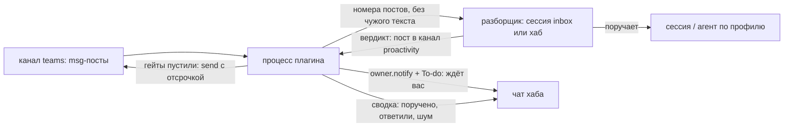

# Proactivity — плагин Agents Hub

Сам разбирает входящие вкладки «Inbox» (Teams, WhatsApp, Telegram, почта — их собирает плагин `teams`) и ведёт их в чат
хаба: что пришло, что с этим сделано, что ждёт вас. Вместо ручного «Черновика сразу» у главной сессии.

Нужен плагин `teams` (Inbox) и API плагинов хаба 1.12+. Модели в плагине нет: разбирает сессия (разборщик), плагин —
детерминированный диспетчер: состояние, гейты, чат, To-do, отправка.

## Что видит владелец

| Где | Что |
|---|---|
| Чат хаба | одно сообщение на дело, которое ждёт вас: кто, о чём, **точное действие** + ссылка. Срочное — «Inbox · срочно» |
| To-do | пункт на то же дело (закрывается сам, когда вы ответили или дело решилось) |
| Сводка в чат | раз в N часов (по умолчанию 3), только если есть что сказать: поручено / ответили / без ответа / шум ×N / «ждёт вас: M» |
| «Настройки → Proactivity» | уровень автономии и частота сводки |
| `hub feed proactivity` | журнал: пост `item` на каждую смену состояния дела |

Шум (боты, автоответы, заглушённые) в чат не идёт — только строкой в сводке. Ночью (23:00–08:00 по часам хаба)
несрочное ждёт утра одним куском.

## Уровни автономии

Настройка владельца, пост `{"kind":"settings","preset":…}` в канал плагина (вкладка в «Настройках» или сессия, которой он сказал слово: `for: mN` — номер его сообщения ей или хабу). **До выбора действует «draft»: людям не уходит ничего.**

| preset | что делает с ответом человеку |
|---|---|
| `escalate` | только сообщает в чат; черновиков нет |
| `draft` (по умолчанию) | кладёт черновик под сообщением в Inbox; отправляет владелец кнопкой |
| `colleagues` | рутину («получил», «спасибо», простой факт) коллегам отправляет сам; остальным — черновик |
| `everyone` | рутину отправляет сам любому; в группах и каналах — если обращаются к владельцу |

Отправка самому — не только выбор владельца: ещё и ключ `"triage": "proactivity"` в `sources.json` плагина teams
(`~/.hub-core/ext-teams/`). Без него teams не принимает `send` от плагина, ответы остаются черновиками.

### Что не настраивается (гейты, rules.py → send_gate)

Отправка самому — только если **все** условия: уровень «сам» для этого отправителя; вид сообщения — рутина (ack/answer);
нет признаков инструкции в чужом тексте; разборщик не отметил риск из стоп-списка владельца (деньги с его счетов —
платёж, покупка, подписка, перевод, цена или скидка вне прайса/тарифа/порога; его подпись и юр. обязательства;
необратимое; его вкус там, где он просил сначала показать; здоровье его и семьи; секреты в тексте); ответ можно
отправить в источник; текст без секретов; владелец сам не ведёт эту беседу прямо сейчас;
не больше 6 отправок в час и не чаще раза в 30 минут одному собеседнику, если он не писал после нашего последнего ответа (написал — отвечаем сразу). Иначе — черновик с причиной в «Почему».
Ночной и выходной запрет, рабочие часы собеседника, подпись «🤖 _Хаб от лица владельца_» только близким (коллеги, семьи; посторонним — никакой) — у teams
(`send`, `hours`); плагин подписывает ответ только если teams пометил `sign`. Отправка идёт с отсрочкой (по умолчанию
2 мин): отменить — в Inbox, пока ответ в «отложенных».

## Как устроено



Состояние дела: `new → asked → delegated | draft | escalated | sending | replied | done | noise | answered | old`.

Каждая смена состояния — пост `item` в канал плагина: `{"kind":"item","id":<id сообщения в канале teams>,"post":"pN","s":<состояние>,"from","where","why","who","noise"}` и, когда есть вердикт, — важность для порядка в Inbox: `do` (вердикт), `urgent: true`, `risk: [...]` (полей нет — не срочно, рисков нет).
Черновик заранее (20.10): каждому делу, где человек ждёт ответа владельца, разборщик кладёт текст сразу — и при `escalate` (черновик, не решающий за владельца, плюс вопрос в `ask`), и когда фактов не хватает (что известно, а чего нет — в `context`); шум, инфо, `wait` и поручённое — без текста.
Живая беседа: пока владелец сам отвечал собеседнику в последние 15 минут, его сообщения разбираются только черновиком — без отправки и без сообщения в чат. Карточку, которую teams закрыл из-за нового сообщения той же переписки (`answered` с `newer`), ответом владельца не считаем. Серия: новое сообщение того же собеседника заменяет его неразобранные (состояние `old`), продолжение в пределах 10 минут ждёт паузы 2 минуты — одна просьба разборщику на серию.

Черновик идёт за перепиской: черновик под постом сообщения (сессии — `hub post teams --reply pN`, разбора, перенесённый), чей пункт новое сообщение той же переписки уже заменило (`answered` с `newer` или серия), плагин кладёт под пост открытого пункта этой переписки — с пометкой «Перенесён из pN» в приватной части. Вердикт разбора, пришедший к уже заменённому пункту, ложится так же. Только черновик, наружу ничего; свой черновик открытого пункта и правку владельца в редакторе перенос не заменяет; черновик старше суток не переносится.
Вложения и ссылки (27.10, владелец): картинки, скачанные сборщиком, — путями в просьбе (разборщик открывает их сам). Видео (и видео-заметки), голосовое без расшифровки и ссылку YouTube плагин разбирает сам до просьбы (`media.py`, свой поток, по одному): речь — командой голоса хаба `voice.cmd` (звук через ffmpeg, архив выключен; видео длиннее 10 мин — только первые 3 мин), 3 кадра ffmpeg, у YouTube — название, канал, длительность, описание и субтитры (`yt-dlp --skip-download`). В строке пункта — начало текста и пути кадров, полностью — файлом в `attachments/inbox/digest`; готовое не считается второй раз. Просьба ждёт разбора не дольше 5 минут; сбой — строка-причина, разбор идёт дальше. Пример: `видео 0:22: речь «Una bajadita, que nos metemos en un camino de tierra…»; кадры: …-f1.jpg; …-f2.jpg; …-f3.jpg`.
Нет вердикта 15 минут — спрашиваем второй раз, потом эскалируем «не разобрано»; поручено и нет итога сутки — эскалация.
Убрал из Inbox: пост клиента `{"kind": "hide", "ids": […]}` в канале teams (только от владельца) закрывает пункт — `ignored`: без разбора, черновика, переноса черновика к новому сообщению и автоответа; отправляемый автоответ снимается `dismiss`. Перепост того же сообщения сборщиком (дочитанный текст) пункт не открывает; новое сообщение переписки — новый пункт, как обычно. «Вернуть» (`unhide`) снимает метку, пункт остаётся закрытым.

Передал в работу (задача): слова владельца с цитатой-ссылкой клиента «пост pN … в `hub feed teams`» (натив — «… — пост pN в …», веб teams — «Пост pN (до него pK, …) в …») — дело поручено адресату его слов (без адреса — хабу) и сразу уходит из Inbox (`dismiss`), как поручение разборщика; уже закрытое, отправляемое и поручённое не трогается. Связь — только номер поста.
Вердикт принимается только от разборщика (сессия `inbox`, а если её нет — хаб). Состояние — `<состояние хаба>/ext-proactivity/state.json`
и посты `item` в канале; после потери файла настройки восстанавливаются из журнала.

Вердикт разборщика — пост в канал плагина (ровно по одному на дело):

```
hub post proactivity '{"kind":"verdict","item":"pN","do":"delegated|reply|draft|escalate|noise|done",
  "type":"ack|answer|task|decision|info|other","why":"…","ask":"…","who":"…","ref":"dN","text":"…","urgent":false,"risk":[]}'
```

## Безопасность

- Чужой текст разборщику не передаётся вовсе — только номера постов и метки (источник, коллега или нет, уровень);
  читает он сам, выводом команды, как данные. Имена отправителей в просьбу тоже не попадают.
- Входящими считаются только посты канала teams, написанные самим плагином teams; вердикты и настройки — только от
  разборщика и владельца (настройки хабу — по слову владельца, номер сообщения проверяется в журнале).
- Признаки инструкции в чужом тексте (`rules.SUSPICIOUS`, те же, что подсвечивает Inbox) закрывают путь отправки.
- Сессии хаба работают без запросов разрешений и пишут в ящик ядра напрямую: подпись автора поста — граница доверия
  ядра, как и для слова владельца. Плагин её не усиливает.

## Установка

Плагин — свой репо (`visualpharm/hub-proactivity`, topic `agents-hub-plugin`); ставит хаб по слову владельца:
`hub market install visualpharm/hub-proactivity`. Или без публикации — расширение из папки в `hub.json`:
`"extensions": {"proactivity": {"path": "<папка плагина>", "run": ["sh", "run.sh"], "web": "main.js"}}`.

Чтобы разбор шёл через плагин, а не «Черновик сразу»: в `sources.json` teams — `"triage": "proactivity"` (нужен teams
с патчем «triage»); пока патча нет — выключить «Черновик сразу» в настройках Inbox.

Сессия-разборщик — отдельный агент `inbox`: `hub session new inbox --agent --about "Разбор входящих Inbox"`. Без неё разбирает хаб, и просьба ждёт конца его текущего хода: приход→вердикт медиана 36 с, но p90 ~31 мин, черновик лежал к открытию у 2 из 10 пунктов. Со своей сессией — ~20 с. Хаб остаётся запасным: его вердикты тоже принимаются. Дело по пункту — сессии, что ведёт переписку или тему : в просьбе разборщику — живые сессии с описанием и «переписку раньше вёл»; разборщик называет её в `who`, и плагин сам шлёт ей поручение (delegated), карточку решения (escalate) и напоминание о зависшем поручении. Нет такой живой сессии — хабу.

Данные самого владельца (имя, DNI, CUIT, адрес, почта, телефон), когда их просит контрагент в живой сделке (накладная, доставка, бронь, счёт), черновик подставляет сам и не пишет «пришлю позже». Источник — справочник владельца `owner-facts.json` в папке настроек хаба (`HUB_CONFIG_DIR`, обычно `~/.config/hub-core/`; плоский JSON «поле → значение», права 600, в репо не лежит) и ранние реплики переписки. Плагин кладёт справочник в каждую просьбу разборщику: она ложится в журнал хаба владельца. Нет файла — разборщик ищет только в переписке. Просьба данных без сделки, паролей, карт и кодов — эскалация.

## Настройки окружения

- `relay` в настройках плагина — сессия, которая пишет людям от имени владельца (пусто — плагин шлёт сам).
- Подписи хаба — настройка `signatures` (по умолчанию «🤖 _Хаб от лица владельца_» и переводы).
- `PROACTIVITY_WA` — команда чтения переписки WhatsApp (`<cmd> thread --cached --json <чат>`), `PROACTIVITY_SEND` — команда
  пометки «прочитано» (`<cmd> wa-read <чат>`). Не заданы — эти проверки выключены.

## Тесты

```
PYTHONPATH=<папка хаба> python3 -m unittest discover -s tests
```

Кейсы для evals (поведение разборщика на настоящей модели): `evals/cases/` — формат `evals/run.py` ядра; пересобрать
после правки просьбы: `PYTHONPATH=<папка хаба> python3 tools/make_evals.py`.

Прогон: `evals/run.py <абсолютные пути кейсов> --only after` (нужен вход claude).
